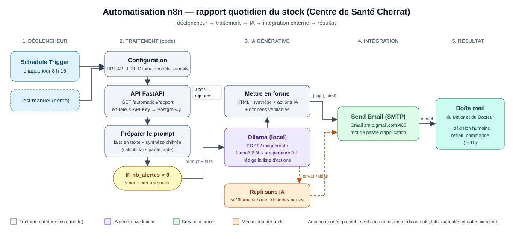

# Automatisation n8n — Rapport quotidien du stock (Centre de Santé Cherrat)

Chaque matin à 8 h 15, n8n interroge l'application **cherrat-stock**, fait rédiger par une IA locale (Ollama) la liste des actions du jour, puis envoie un e-mail au Major et au Docteur : lots expirés à retirer, lots qui expirent sous 30 jours, ruptures et stocks bas.

| Fichier | Contenu |
|---|---|
| `workflow_n8n_cherrat.json` | Workflow n8n exporté (à importer) |
| `README.md` | Ce guide : installation et utilisation |
| `ENVIRONNEMENT.md` | Environnement technique et dépendances (versions) |
| `architecture.svg` | Schéma de la chaîne déclencheur → traitement → IA → intégration → résultat |
| `CREDENTIALS.md` | Registre des credentials et des variables |
| `TEST_TRANSFERABILITE.md` | Protocole du test avec un ami + grille de réflexion |

## 1. Le problème

Sans automatisation, quelqu'un doit ouvrir l'application chaque jour, lire le tableau de bord et prévenir l'équipe. En pratique, personne ne le fait tous les jours, et un lot périmé ou une rupture est découvert trop tard. Le workflow pousse l'information vers les responsables, sans qu'ils aient à la chercher.

## 2. Comment ça marche



| # | Nœud n8n | Type | Rôle |
|---|---|---|---|
| 1 | Chaque jour à 8 h 15 / Test manuel | Schedule Trigger / Manual Trigger | Déclenche le workflow |
| 2 | Configuration | Set | Adresses de l'API et d'Ollama, modèle, expéditeur et destinataires |
| 3 | API - Rapport du stock | HTTP Request (Header Auth) | `GET /automation/rapport` : faits calculés par le backend à partir de PostgreSQL |
| 4 | Préparer le prompt | Code (JavaScript) | Met les faits en texte, calcule la phrase de synthèse, construit le prompt |
| 5 | Des alertes ? | IF | S'il n'y a aucune alerte, on n'envoie rien |
| 6 | Ollama - Rédiger les actions | HTTP Request | `POST /api/generate` (llama3.2:3b, température 0,1) |
| 7a | Mettre en forme (IA) | Code | E-mail HTML : synthèse + actions rédigées par l'IA + données brutes vérifiables |
| 7b | Repli sans IA | Code | Si Ollama échoue (arrêté, délai dépassé), on envoie quand même les données brutes |
| 8 | Envoyer l'e-mail | Send Email (SMTP) | Envoi au Major et au Docteur |

**Répartition du travail entre le code et l'IA :** les comptes, les dates et les jours restants sont calculés par le code (backend et nœud *Préparer le prompt*). Le LLM ne fait que rédiger. Lors des tests, le modèle 3B annonçait « 2 problèmes » alors qu'il y en avait 4. Depuis, la phrase chiffrée est écrite par le code, et l'e-mail montre toujours les données brutes sous le texte de l'IA, pour que le lecteur puisse vérifier.

### Prompt envoyé à Ollama (extrait)

```text
Tu es l'assistant de gestion du stock de médicaments du Centre de Santé Cherrat.
Rédige en français la liste des actions du jour pour le Docteur et le Major, à partir des FAITS ci-dessous.
Règles :
- Utilise UNIQUEMENT les faits fournis. N'invente aucun médicament, aucune quantité, aucune date.
- Écris uniquement une liste à puces d'actions, de la plus urgente à la moins urgente :
  1) retirer les lots expirés, 2) utiliser en premier les lots qui expirent sous 30 jours,
  3) commander les médicaments en rupture, 4) commander les médicaments en stock bas.
- Chaque ligne cite le médicament, le numéro de lot s'il existe et la quantité, recopiés exactement.
- Aucun conseil médical, de prescription ou de posologie. 120 mots maximum.
FAITS :
{faits calculés par le code}
```

### Exemple de résultat (données de démonstration de `seed.py`)

> **4 alerte(s) à traiter aujourd'hui : 1 lot(s) expiré(s), 1 lot(s) expirant sous 30 jours, 1 rupture(s), 1 stock(s) bas.**
> Actions prioritaires :
> - Retirer les lots expirés, lot SER-100 : 15 unité(s)
> - Utiliser en premier les lots qui expirent sous 30 jours, lot AMX-014 : 60 unité(s)
> - Commander les médicaments en rupture, sérum physiologique 0,9 % : 0 unité(s)
> - Commander les médicaments en stock bas, ibuprofène 400 mg : 12 unité(s)
>
> *(suivi des données calculées par l'application)*

Temps mesuré pour l'appel à Ollama avec llama3.2:3b sur le PC de développement : 20 à 30 secondes.

**Tests réalisés (n8n 2.16.1, 26/11/2026)** : import du JSON par `n8n import:workflow`, exécution complète avec l'API, Ollama et Mailpit (e-mail reçu avec 4 alertes), puis exécution avec une adresse Ollama injoignable (e-mail « (sans IA) » reçu par la branche de repli). L'envoi par Gmail n'a pas été testé.

## 3. Installation sur une nouvelle machine (≈ 45 min, hors téléchargements)

Prérequis : Windows 10/11 (ou macOS/Linux), 8 Go de RAM minimum, Docker Desktop, Python 3.11, Node.js 20+, Ollama. Le détail des versions est dans [ENVIRONNEMENT.md](ENVIRONNEMENT.md).

### Étape 1 — Récupérer le projet

```powershell
git clone <url-du-depot> cherrat-stock
cd cherrat-stock
```

### Étape 2 — Démarrer PostgreSQL, Qdrant et n8n

Lancez Docker Desktop, attendez qu'il affiche « Engine running », puis :

```powershell
docker compose up -d
docker compose ps
```

Contrôle : `cherrat_db`, `cherrat_qdrant` et `cherrat_n8n` sont `running`.

### Étape 3 — Télécharger les modèles d'IA

```powershell
ollama pull llama3.2:3b
ollama pull nomic-embed-text
ollama list
```

### Étape 4 — Configurer et lancer le backend

```powershell
cd backend
Copy-Item .env.example .env
py -3.11 -m venv .venv
.venv\Scripts\Activate.ps1
pip install -r requirements.txt
```

Ouvrez `backend\.env` et remplacez `SECRET_KEY` et `AUTOMATION_API_KEY` par deux valeurs aléatoires générées avec :

```powershell
python -c "import secrets;print(secrets.token_urlsafe(32))"
```

Puis créez les données de démonstration et lancez l'API **en écoutant sur toutes les interfaces**, pour que le conteneur n8n puisse la joindre :

```powershell
python -m app.seed
uvicorn app.main:app --host 0.0.0.0 --port 8000
```

Contrôle : <http://localhost:8000/docs> s'ouvre et la route `GET /automation/rapport` y apparaît.

### Étape 5 — (Facultatif) Lancer l'interface web

Dans un autre terminal :

```powershell
cd frontend
Copy-Item .env.example .env
npm install
npm run dev
```

Puis ouvrez <http://localhost:5173>. Comptes de démonstration : `major@cherrat.ma` / `Major123!`, `docteur@cherrat.ma` / `Docteur123!`, `infirmiere@cherrat.ma` / `Infirmier123!`.

### Étape 6 — Importer le workflow dans n8n

1. Ouvrez <http://localhost:5678> et créez le compte propriétaire n8n (local).
2. Menu **Workflows → Import from File** → `automatisation/workflow_n8n_cherrat.json`.
3. Créez les deux credentials décrits dans [CREDENTIALS.md](CREDENTIALS.md) : **Cherrat API Key** (Header Auth) et **SMTP Cherrat** (SMTP), puis sélectionnez-les dans les nœuds *API - Rapport du stock* et *Envoyer l'e-mail*.
4. Ouvrez le nœud **Configuration** et remplacez `EMAIL_FROM` et `EMAIL_TO` par vos adresses.
5. Cliquez sur **Execute workflow** (« Test workflow » dans les anciennes versions). Après 20 à 60 secondes, l'e-mail arrive.
6. Activez (ou publiez, selon la version de n8n) le workflow pour l'envoi automatique chaque jour à 8 h 15.

> Si vous lancez n8n sans Docker (`npx n8n`), remplacez `host.docker.internal` par `localhost` dans le nœud **Configuration**.

### Étape 7 — (Facultatif) Tester sans compte Gmail

Un serveur e-mail de test, Mailpit, capture les messages sans rien envoyer sur Internet :

```powershell
docker compose --profile test up -d mailpit
```

Dans le credential **SMTP Cherrat**, mettez Host `host.docker.internal`, Port `1025`, User et Password vides, SSL/TLS désactivé, puis exécutez le workflow. L'e-mail apparaît sur <http://localhost:8025>.

### Exécuter le workflow en ligne de commande

Utile pour vérifier l'installation sans l'interface. Remplacez `<id>` par l'identifiant affiché par la première commande :

```powershell
docker exec cherrat_n8n n8n list:workflow
```

```powershell
docker exec -e N8N_RUNNERS_BROKER_PORT=5690 cherrat_n8n n8n execute --id=<id>
```

La variable `N8N_RUNNERS_BROKER_PORT` évite un conflit de port avec l'instance n8n déjà lancée dans le conteneur.

## 4. Utilisation au quotidien

- Rien à faire : l'e-mail arrive chaque matin s'il y a au moins une alerte.
- Le Major lit les actions, **vérifie avec les données brutes** en bas de l'e-mail, puis agit dans l'application (retrait, sortie FEFO, commande). L'automatisation informe, l'humain décide.
- Pour changer l'heure : nœud *Chaque jour à 8 h 15*. Pour changer les destinataires : nœud *Configuration*.
- Historique des exécutions : onglet **Executions** de n8n.

## 5. Tester les cas limites

| Situation | Comment la provoquer | Résultat attendu |
|---|---|---|
| Normal | Données de `seed.py` | E-mail avec 4 alertes et la liste d'actions IA |
| Aucune alerte | Corriger le stock dans l'application | Branche *Rien à signaler*, aucun e-mail |
| Ollama arrêté | Quitter Ollama, ou mettre un mauvais port dans `OLLAMA_URL` | E-mail « (sans IA) » avec les données brutes |
| Mauvaise clé API | Modifier la valeur du credential | Le nœud API échoue avec une erreur 401 (visible dans Executions) |
| Backend arrêté | Arrêter uvicorn | Le nœud API réessaie 3 fois puis échoue |

## 6. Dépannage

| Symptôme | Cause probable | Solution |
|---|---|---|
| `ECONNREFUSED host.docker.internal:8000` | uvicorn lancé sans `--host 0.0.0.0`, ou pare-feu Windows | Relancer avec `--host 0.0.0.0` ; autoriser Python dans le pare-feu |
| `ECONNREFUSED …:11434` | Ollama n'écoute que sur 127.0.0.1 | Définir la variable d'environnement Windows `OLLAMA_HOST=0.0.0.0`, puis redémarrer Ollama |
| `503 Automatisation désactivée` | `AUTOMATION_API_KEY` vide dans `backend/.env` | La renseigner, puis redémarrer uvicorn |
| `401 Clé API invalide` | Credential n8n différent du `.env` | Recopier exactement la même valeur |
| `model "…" not found` | Modèle non téléchargé | `ollama pull llama3.2:3b`, ou changer `LLM_MODEL` dans *Configuration* |
| Erreur SMTP `535` | Mot de passe Gmail normal utilisé | Utiliser un **mot de passe d'application** (voir CREDENTIALS.md) |
| Délai dépassé sur Ollama | PC lent, premier chargement du modèle | Relancer ; le premier appel charge le modèle en mémoire |
| Docker : `dockerDesktopLinuxEngine` introuvable | Docker Desktop n'est pas démarré | Lancer Docker Desktop et attendre « Engine running » |
